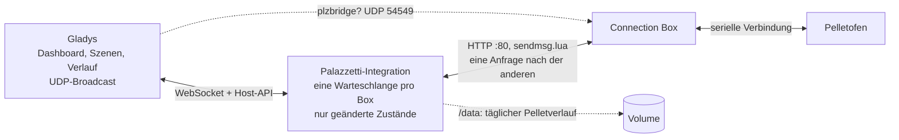
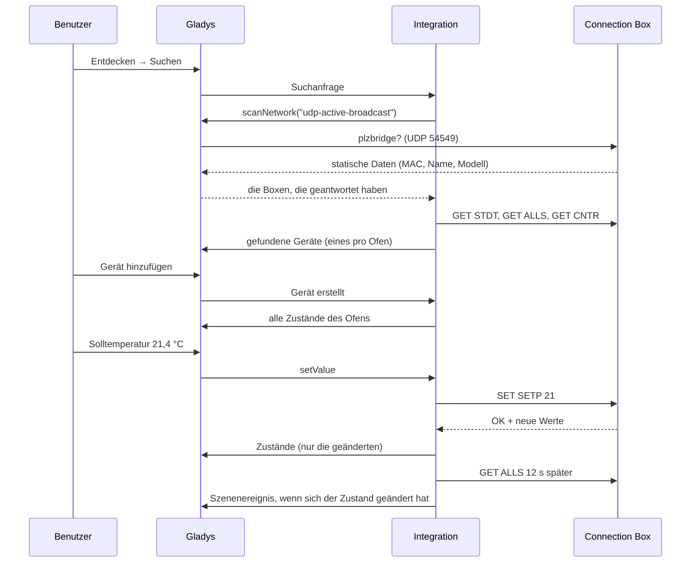
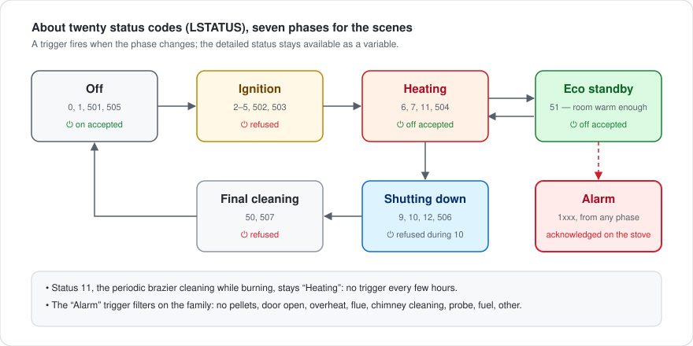
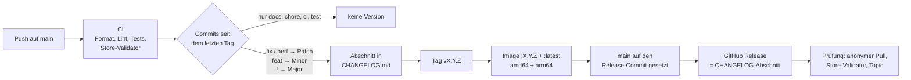

[English](README.md) · [Français](README.fr.md) · **Deutsch** · [Español](README.es.md)

# gladys-palazzetti

[](LICENSE)
[](https://github.com/William-De71/gladys-palazzetti/releases)
[](https://github.com/William-De71/gladys-palazzetti/actions/workflows/release.yml)
[](https://gladysassistant.com)


Externe [Gladys Assistant](https://gladysassistant.com)-Integration für **Palazzetti**-Pelletöfen über die lokale API der **Connection Box**. Mit einem Klick aus dem Store installiert, spricht sie direkt mit der Box in Ihrem lokalen Netzwerk: keine Palazzetti-Cloud, kein Konto, keine MQTT-Brücke. Schalten Sie den Ofen ein und aus, stellen Sie Temperatur, Leistungsstufe und Gebläse ein, verfolgen Sie Temperaturen, Alarme und Pelletverbrauch, reagieren Sie in Szenen darauf und steuern Sie ihn vom Dashboard aus.

📖 Benutzerdokumentation: [English](docs/en.md) — [Français](docs/fr.md) — [Deutsch](docs/de.md) — [Español](docs/es.md)

Entstanden aus dem Thread der Gladys-Community [Connexion poêle Palazzetti](https://community.gladysassistant.com/t/connexion-poele-palazzetti/9943).

## Funktionen

- **Automatische Suche**: Gladys sendet die Anfrage der Connection Box ins lokale Netzwerk; eine Box in einem anderen VLAN lässt sich von Hand eintragen, und eine Box mit neuer IP-Adresse wird über ihre Kennung wiedergefunden.
- **Der ganze Ofen**: Ein/Aus, Solltemperatur, Heizbetrieb, Temperaturen, Status, Alarm, Leistungsstufe, Gebläse, Leisemodus, Wochenprogramm, verbrannte Pellets, Pelletfüllstand und Zähler — je nach Modell.
- **Befehle, die der Ofen annimmt**: Ein/Aus nur aus den Zuständen, in denen die Box es akzeptiert, Werte auf das Modell begrenzt; ein abgelehnter Befehl wird nie gesendet, und Gladys nennt den Grund.
- **Szenen**: 6 Auslöser (Zustand geändert, Alarm, Alarm behoben, Pellets gehen aus, Ofen nicht erreichbar / wieder erreichbar) und 2 Aktionen (Ofen lesen, Ofen einstellen).
- **Dashboard-Widgets**: der Ofen (Live-Kacheln, 24-h-Kurve, Zustand, Tasten) und der Pelletverbrauch (kg pro Tag, Säcke pro Woche, Zähler).
- **Vier Sprachen**: Englisch, Französisch, Deutsch und Spanisch, in Gladys und in der Dokumentation.

## Funktionsweise




Die Connection Box antwortet per einfachem HTTP auf Port 80: `GET /cgi-bin/sendmsg.lua?cmd=GET+ALLS`, ein JSON-Umschlag `{ INFO, SUCCESS, DATA }`. Sie leitet jeden Befehl über eine langsame serielle Verbindung an den Ofen weiter, deshalb:

- **eine Anfrage nach der anderen pro Box** — überlappende Anfragen lassen sie in ein Timeout laufen oder abstürzen (WPalaControl #69, Home Assistant #140215); jede Box hat ihre eigene Warteschlange;
- **eine Antwort ist nur ein Erfolg, wenn `SUCCESS` wahr _und_ `INFO.RSP` gleich `OK` ist** — die Box antwortet mit HTTP 200 und `RSP: "TIMEOUT"`, wenn der Ofen schweigt;
- **Befehle sind absolute Werte** (`SET SETP 21`, nie `+1`), daher wird eine unbeantwortete Anfrage gefahrlos einmal wiederholt.

Jeder Ofen wird in einer Schleife gelesen: `GET ALLS` bei jedem Abfrageintervall (standardmäßig 30 s), `GET CNTR` alle 10 Minuten, `GET STDT` einmal am Tag. Die Box sendet nichts von sich aus; die Schleife treibt Zustände, Szenen und Widgets an.

Von der Suche bis zu einem Befehl und seinem Zustand:




### Suche

Eine Connection Box beantwortet die per Broadcast auf Port **54549** gesendete UDP-Anfrage `plzbridge?` mit ihren statischen Daten, per Unicast an den Absender. Der Container der Integration liegt in einem Bridge-Netzwerk und kann nicht ins lokale Netzwerk broadcasten, daher läuft die Anfrage über den Kern:

```json
"network_discovery": [{ "type": "udp-active-broadcast", "ports": [54549] }]
```

Die Suche wird mit den in der Konfiguration eingetragenen Adressen und den bereits erstellten Öfen zusammengeführt. Antwortet eine Box dreimal hintereinander nicht (neue DHCP-Adresse), findet eine neue Suche sie über ihre Kennung wieder, und der Parameter `IP_ADDRESS` des Geräts wird aktualisiert.

### Abbildungsentscheidungen

- **Ein/Aus ist ein `thermostat/mode`** (Aus / Heizen), neben `thermostat/target-temperature` und `thermostat/operating-state`: Für Gladys ist der Ofen ein Thermostat, das nur heizt.
- **Leistungsstufe und Gebläse sind `text/select`.** Gladys hat keinen Typ „Heizstufe“, und die Gebläse kennen Aus, 1–5, Maximal und Auto, was `fan/mode` (drei Stufen) nicht beschreiben kann. Die Optionen folgen dem, was das Modell meldet (`FANLMINMAX`, `FAN2MODE`, `FAN2TYPE`).
- **Der Alarm ist ein `unknown/binary`**, der einzige generische Binärwert, den das Gladys-Frontend beschriftet; der Status-Text nennt ihn.
- **Statuscodes werden zu Phasen gruppiert** (aus, Zündung, Heizen, Eco, Abschaltung, Reinigung, Alarm) für die Auslöser. Die periodische Brennschalenreinigung (Status 11) bleibt „Heizen“ und löst daher nie einen Phasenwechsel aus.
- **Die Fähigkeiten folgen pypalazzetti** und dem offiziellen Palazzetti-SDK: Ein/Aus nur aus den Status, die die Box akzeptiert, kein Fern-Ein/Aus bei Holzöfen, der geregelte Fühler aus `MAINTPROBE`/`UICONFIG`, `65535` = nicht geliefert, ein Fühler bei 0 = nicht vorhanden.
- **Der Tagesverbrauch wird von der Integration berechnet**: Der Ofen meldet nur einen kumulierten Zähler, der Tag für Tag in `/data/pellets-<id>.json` gespeichert wird. Kleine Rückgänge des Zählers sind Störungen; ein großer ist ein Zurücksetzen bei der Wartung.



## Unterstützte Funktionen

| Funktion                            | Gladys-Kategorie / -Typ                           | Hinweis                                                          |
| ----------------------------------- | ------------------------------------------------- | ---------------------------------------------------------------- |
| Ein / Aus                           | `thermostat` / `mode`                             | Aus / Heizen; abgelehnt während Zündung, Abschaltung und Alarm   |
| Solltemperatur                      | `thermostat` / `target-temperature`               | Ganze Grad, im Bereich `SPLMIN`..`SPLMAX` des Ofens              |
| Heizbetrieb                         | `thermostat` / `operating-state`                  | Der Ofen erzeugt Wärme (Zündung oder Verbrennung)                |
| Raumtemperatur                      | `temperature-sensor` / `decimal`                  | Der geregelte Fühler (das geregelte Wasser bei einem Hydro-Ofen) |
| Abgas, Wasser, Luftaustritt         | `temperature-sensor` / `probe`                    | Die übrigen vorhandenen Fühler                                   |
| Status                              | `text` / `text`                                   | Verbrennung, Eco-Modus, Abkühlung … oder der Alarm im Klartext   |
| Alarm                               | `unknown` / `binary`                              | 1, solange der Ofen im Alarm ist                                 |
| Leistungsstufe                      | `text` / `select`                                 | 1 bis 5                                                          |
| Raumgebläse, Gebläse links / rechts | `text` / `select`                                 | Aus, Stufen, Maximal, Auto, je nach Modell                       |
| Leisemodus                          | `button` / `push`                                 | Alle Gebläse aus (Modelle mit mehreren Gebläsen)                 |
| Wochenprogramm                      | `switch` / `binary`                               | Das Programm des Ofens (`CHRONOTYPE` > 1)                        |
| Verbrannte Pellets (kg)             | `counter-sensor` / `integer`                      | Kumulierter Zähler                                               |
| Pelletfüllstand / Behälter leer     | `level-sensor` / `liquid-depth`, `unknown/binary` | Je nach Füllstandssensor des Behälters (`PSENSTYPE`)             |
| Zündungen, Heizstunden, Wartung     | `counter-sensor`, `duration` / `integer`          | Alle 10 Minuten gelesen (`GET CNTR`)                             |

Aktionen der Konfigurationsseite: **Verbindung testen** (sucht die Boxen und liest jeden Ofen) und **Ofenuhr stellen** (stellt die Uhr, die das Wochenprogramm nutzt, auf die Zeit von Gladys, nach einem Stromausfall oder einer Zeitumstellung).

## Konfiguration

| Feld                        | Standard | Verwendung                                                                                                |
| --------------------------- | -------- | --------------------------------------------------------------------------------------------------------- |
| Adressen der Connection Box | leer     | Nur wenn die Suche Ihren Ofen nicht findet: IP-Adressen durch Kommas getrennt                             |
| Abfrageintervall (s)        | 30       | Wie oft jeder Ofen gelesen wird, 10 bis 300 s: Die Box sendet nichts, es ist die Reaktionszeit der Szenen |

Geben Sie der Connection Box nach Möglichkeit eine feste IP-Adresse in Ihrem Router: Die Integration findet eine umgezogene Box wieder, aber einige Minuten später.

## Transport

Die Connection Box ist nur lokal erreichbar: Das Manifest deklariert `"transports": ["local"]`, und jedes Ofen-Gerät trägt ein Transport-Abzeichen — **lokal**, solange seine Box antwortet, **nicht erreichbar** nach drei Abfragen ohne Antwort. Dieselben Übergänge lösen die Szenen _Ofen nicht erreichbar_ und _Ofen wieder erreichbar_ aus.

## Widgets


- **Palazzetti-Ofen** (`stove`) — Raumtemperatur und Soll als Live-Kacheln, die Kurve der letzten 24 Stunden, der Zustand (Alarm in Rot), Leistung, Gebläse, Abgas, Pellets und Programm sowie vier Tasten: Einschalten / Ausschalten (Ausschalten mit Bestätigung), −1 °C, +1 °C und Leistung → nächste. Einstellungen: der Ofen, die Temperaturkurve (ohne sie erhält die Leistungsstufe eine Kachel).
- **Pelletverbrauch** (`consumption`) — heute verbrannte Pellets, Durchschnitt pro Tag, Gesamt, die Balken der letzten Tage, 15-kg-Säcke pro Woche, Zündungen, Heizstunden und Stunden seit der Wartung. Einstellungen: der Ofen, die angezeigten Tage (7 bis 60, standardmäßig 14). Der Tagesverlauf wird aus dem Zähler des Ofens berechnet: Er erscheint nach einem ersten vollen Tag.

Die Bilder werden von `docs/illustrations/render.sh` aus dem Widget-Code erzeugt (ein erfundener Winterabend, gezeichnet wie im Gladys-Frontend), es sind keine Screenshots eines laufenden Gladys.

## Szenen

Jeder Auslöser lässt sich auf einen Ofen beschränken (leer für alle). Der Ofen wird in einer Schleife gelesen: Ein Auslöser feuert höchstens ein Abfrageintervall nach dem Ereignis.

| Auslöser                           | Wann                                                                                       | Variablen                                                                                                     |
| ---------------------------------- | ------------------------------------------------------------------------------------------ | ------------------------------------------------------------------------------------------------------------- |
| Palazzetti: Ofenzustand geändert   | Neuer Zustand: Aus, Zündung, Heizt, Eco-Bereitschaft, Abschaltung, Endreinigung, Alarm     | `phase`, `previous_phase`, `phase_label`, `status_label`, `status_code`, `temperature`, `setpoint`, `summary` |
| Palazzetti: Alarm                  | Ein Alarm tritt auf, filterbar nach Typ: keine Pellets, Tür, Überhitzung, Zug, Rauchrohr … | `alarm_label`, `alarm_type`, `alarm_code`, `summary`                                                          |
| Palazzetti: Alarm behoben          | Der Ofen ist nicht mehr im Alarm                                                           | `alarm_label`, `alarm_code`, `phase`, `summary`                                                               |
| Palazzetti: Pellets gehen aus      | Der Füllstandssensor meldet einen niedrigen Stand (ausgestattete Modelle)                  | `pellet_level`, `summary`                                                                                     |
| Palazzetti: Ofen nicht erreichbar  | Die Connection Box hat dreimal hintereinander nicht geantwortet                            | `summary`                                                                                                     |
| Palazzetti: Ofen wieder erreichbar | Sie antwortet wieder                                                                       | `phase`, `temperature`, `summary`                                                                             |

Jeder Auslöser liefert außerdem `stove_name`. `summary` (Zusammenfassung) ist ein versandfertiger Satz, z. B. „Wohnzimmer ist im Alarm: Keine Pellets.“

| Aktion                      | Felder                                                       | Ausgaben                                                                                                                                                                               |
| --------------------------- | ------------------------------------------------------------ | -------------------------------------------------------------------------------------------------------------------------------------------------------------------------------------- |
| Palazzetti: Ofen lesen      | Ofen                                                         | `stove_name`, `on`, `heating`, `phase`, `status_label`, `alarm`, `alarm_label`, `temperature`, `setpoint`, `power_level`, `fan`, `flue_gas_temperature`, `pellets_consumed`, `summary` |
| Palazzetti: Ofen einstellen | Ofen, Ein / Aus, Solltemperatur, Leistungsstufe, Raumgebläse | `changed`, `phase`, `summary`                                                                                                                                                          |

**Ofen einstellen** sendet die Einstellungen vor der Zündung, damit der Ofen mit der richtigen Solltemperatur startet; leere Felder ändern nichts, und ein abgelehnter Wert (Alarm, eine Stufe, die das Modell nicht anbietet) lässt die Aktion mit dem Grund fehlschlagen. Ereignisse entstehen aus den am Ofen gelesenen Übergängen, nie aus einer Aktion der Integration selbst.

Beispiele:

- _Palazzetti: Alarm_, Typ „Keine Pellets“ → Nachricht `{{summary}}` senden.
- _Palazzetti: Ofenzustand geändert_ zu „Aus“ → Rollläden schließen.
- Jeden Werktag um 06:00, wenn das Haus bewohnt ist → _Palazzetti: Ofen einstellen_: Einschalten, Solltemperatur 20 °C, Leistung 3.
- _Palazzetti: Ofen lesen_ um 22:00, dann eine Bedingung auf `on` → ausschalten, wenn niemand zu Hause ist.

## Installation

1. In Gladys (5.1.1 oder neuer): **Integrationen → Store**, nach **Palazzetti** suchen, installieren.
2. **Entdecken → Suchen**, dann Ihren Ofen hinzufügen. Nicht gefunden? Tragen Sie die IP-Adresse der Connection Box in der Konfiguration ein und suchen Sie erneut.
3. Fügen Sie die Widgets **Palazzetti-Ofen** und **Pelletverbrauch** zum Dashboard hinzu.

Die [Benutzerdokumentation](docs/de.md) erläutert die Voraussetzungen, die Funktionen des Geräts, die Szenen und die Fehlerbehebung.

## Entwicklung

```bash
npm install
GLADYS_HOST_API_URL="http://localhost:1443" \
GLADYS_INTEGRATION_TOKEN="<token>" \
GLADYS_INTEGRATION_SELECTOR="palazzetti" \
DATA_DIR=./data \
npm start
```

```
index.js                     nur die SDK-Verdrahtung: createApp(new GladysIntegration()) + connect
src/
  app.js                     alle Handler: Suche, Befehle, Szenen, Widgets, Aktionen
  config.js                  Normalisierung der Konfiguration, eingetragene Adressen, Sprachen
  manager.js                 bekannte Öfen, Leseschleife, Befehle, IP-Nachverfolgung
  device.js                  Gladys-Gerät und Zustände eines Ofens
  commands.js                Gladys-Wert -> Befehl an die Box, Ablehnungen erklärt
  events.js                  Übergänge von Lesung zu Lesung -> Szenenereignisse
  scene-actions.js           get_status / control
  widgets.js                 Inhalte der Widgets Ofen und Verbrauch
  history.js                 täglicher Pelletverlauf in /data
  i18n.js                    alle Laufzeittexte, en / fr / de / es
  palazzetti/
    client.js                HTTP-Client: eine Warteschlange pro Box, Prüfung des Umschlags
    discovery.js             UDP-Anfrage, Antworten, stabile Ofenkennung
    stove.js                 Fähigkeiten und Werte eines Ofens
    constants.js             Status, Phasen, Alarme, Gebläse
docs/illustrations/          render.sh: die generierten Widget-Bilder in docs/assets
```

Die Plattformkennung ist die **MAC-Adresse der Box** (zuerst WLAN, dann die aktive Schnittstelle, dann Ethernet), die Seriennummer, wenn keine MAC gültig ist. Nie die IP (DHCP) und nie der Name (in der Palazzetti-App änderbar).

```
device : ext:<selector>:stove:<mac>
feature: ext:<selector>:stove:<mac>:<key>     key = mode, setpoint, room, fan-main, ...
```

## Tests

```bash
npm test               # node --test, greift nie aufs Netzwerk zu
npm run lint           # ESLint
npm run format:check   # Prettier, wie in der CI
npx github:GladysAssistant/integration-store . --skip-image-check
docs/illustrations/render.sh   # nach jeder Änderung eines Widget-Inhalts
```

Die Tests laufen auf echten Antworten von Connection Boxen (Ginger, Julie Pro 2) und prüfen jeden Widget-Inhalt mit `validateWidgetContent` aus dem SDK. `test/structure.test.js` vergleicht die Suche mit `test/fixtures/discovery.baseline.json` und die Schlüssel des Manifests mit `test/fixtures/manifest.baseline.json`, beide aus v1.0.1 erzeugt: Eine geänderte externe Kennung, Kategorie, ein Typ oder Schlüssel würde die Benutzer zwingen, ihre Geräte oder Szenen neu anzulegen. `test/app.test.js` steuert die Handler mit dem Fake-Gladys des SDK; `test/i18n.test.js` prüft die vier Sprachen des Manifests, der Meldungen, der Dokumentation und dieser READMEs.

## Veröffentlichung

Versionen entstehen automatisch. Jeder Push auf `main` startet die CI und berechnet dann die nächste Version aus den Conventional Commits seit dem letzten Tag:



Das Manifest erreicht `main` erst, wenn sein Image existiert: Der Store kündigt nie eine Version an, die er nicht laden kann. `CHANGELOG.md` wird erzeugt: niemals von Hand bearbeiten. **Actions → Release → Run workflow** bietet `release-as` (eine Version erzwingen) und `dry-run` (Version und Notizen anzeigen, ohne zu veröffentlichen).

Commit- und Pull-Request-Titel folgen den [Conventional Commits](https://www.conventionalcommits.org/), auf Englisch, geschrieben als die Changelog-Zeile, die der Benutzer lesen wird: `feat(widgets): show the pellet level on the stove widget`.

- Ein geschütztes `main` würde den Release-Commit ablehnen: Erlauben Sie GitHub Actions, die Regel zu umgehen (Settings → Rules → Bypass list), oder verwenden Sie das Token einer GitHub App.
- Die Prüfung verlangt das Topic `gladys-assistant-integration` am Repository (**About → ⚙️ → Topics**), neben `gladys`, `palazzetti`, `pellet-stove`, `connection-box`, `home-automation`. Die Beschreibung unter **About** entspricht der `description` des Manifests.

## Fehlerbehebung

| Symptom                            | Wahrscheinliche Ursache                                                                                                                   |
| ---------------------------------- | ----------------------------------------------------------------------------------------------------------------------------------------- |
| Kein Ofen gefunden                 | Broadcast gefiltert (VLAN, Gäste-WLAN): Adresse der Box eintragen; `http://IP_DER_BOX/cgi-bin/sendmsg.lua?cmd=GET+STAT` muss JSON liefern |
| „Der Ofen antwortet der Box nicht“ | Die Box antwortet, der Ofen nicht: Kabel zwischen beiden prüfen und ob der Ofen Strom hat                                                 |
| Ein Befehl wird abgelehnt          | Kein Ein/Aus während Zündung, Abschaltung oder Alarm; die Gebläse nehmen nur die Stufen des Modells an                                    |
| Temperaturen bleiben leer          | Ein Fühler bei 0 gilt als nicht vorhanden: Nicht jedes Modell hat alle Fühler                                                             |
| Der Tagesverbrauch ist leer        | Er füllt sich Tag für Tag; manche Platinen anderer Marken melden ihren Pelletzähler nicht                                                 |

Protokolle: **Integrationen → Palazzetti → Protokolle**; fügen Sie `DEBUG=gladys-integration-sdk` zum Container hinzu, um die Details des SDK zu sehen.

## Mitwirken

Issues und Pull Requests sind willkommen: [Fehler melden](https://github.com/William-De71/gladys-palazzetti/issues/new?template=bug_report.yml) (Versionen von Gladys und der Integration, Ofenmodell, Protokolle) oder [Funktion vorschlagen](https://github.com/William-De71/gladys-palazzetti/issues/new?template=feature_request.yml). Rückmeldungen und Fragen auch im [Forum-Thread](https://community.gladysassistant.com/t/9943). Sicherheitsprobleme: siehe [SECURITY.md](SECURITY.md).

Das Wissen über das Protokoll stammt aus [pypalazzetti](https://github.com/dotvav/py-palazzetti-api) (der Bibliothek der Home-Assistant-Integration), dem [offiziellen Palazzetti Asset Parser SDK](https://github.com/palazzetti/palazzetti-sdk-asset-parser-nodejs) und dem Emulator [WPalaControl](https://github.com/Domochip/WPalaControl). Gebaut auf dem [Gladys-Integrations-SDK](https://github.com/GladysAssistant/integration-sdk-js).

## Lizenz

[Apache-2.0](LICENSE) — siehe auch [NOTICE](NOTICE). Community-Integration, weder mit Palazzetti Lelio S.p.A. verbunden noch von ihr unterstützt; „Palazzetti“ und sein Logo sind Marken ihres Inhabers und werden hier nur genannt, um die kompatiblen Öfen zu bezeichnen.
