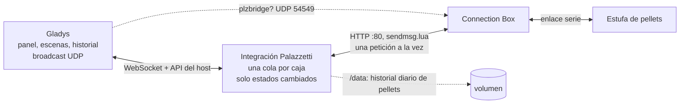
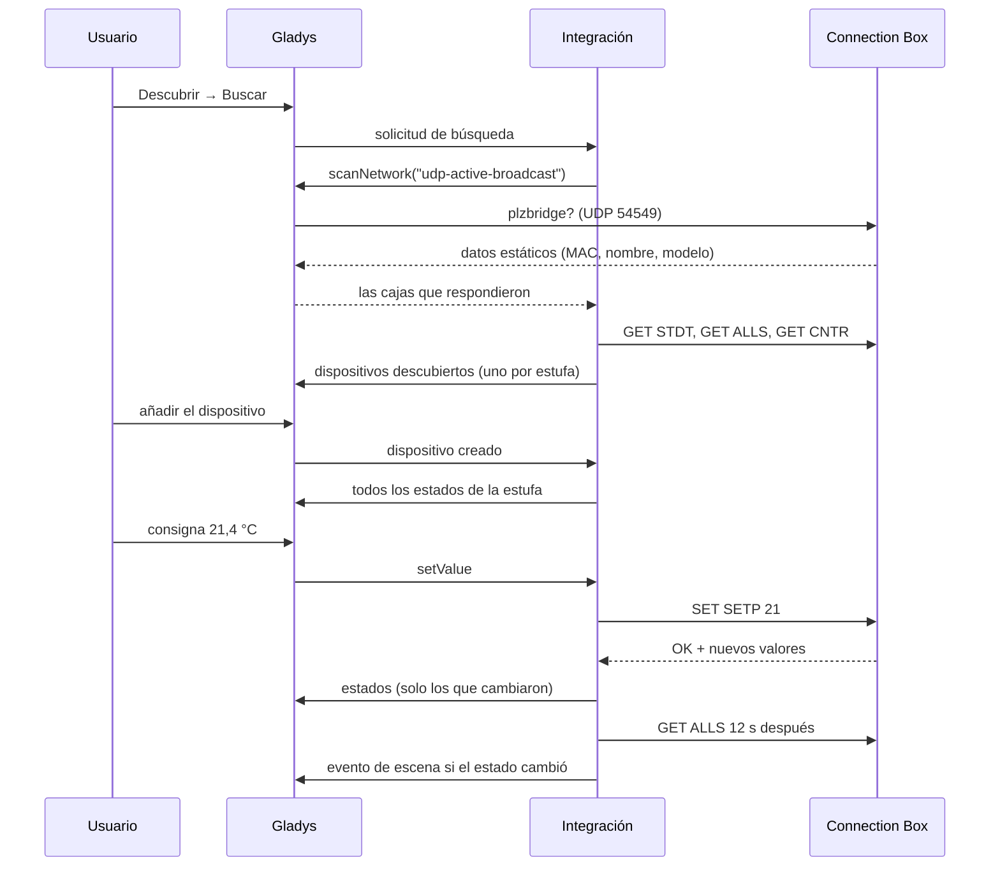
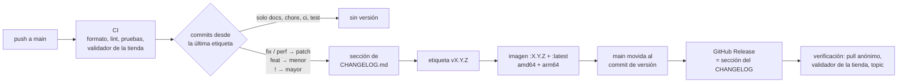

[English](README.md) · [Français](README.fr.md) · [Deutsch](README.de.md) · **Español**

# gladys-palazzetti

[](LICENSE)
[](https://github.com/William-De71/gladys-palazzetti/releases)
[](https://github.com/William-De71/gladys-palazzetti/actions/workflows/release.yml)
[](https://gladysassistant.com)


Integración externa de [Gladys Assistant](https://gladysassistant.com) para las estufas de pellets **Palazzetti**, mediante la API local de la **Connection Box**. Se instala desde la tienda con un clic y habla directamente con la caja en su red local: sin nube de Palazzetti, sin cuenta, sin pasarela MQTT. Encienda y apague la estufa, ajuste la temperatura, la potencia y los ventiladores, siga sus temperaturas, alarmas y consumo de pellets, reaccione a ellos en las escenas y contrólela desde el panel.

📖 Documentación de usuario: [English](docs/en.md) — [Français](docs/fr.md) — [Deutsch](docs/de.md) — [Español](docs/es.md)

Nacida del hilo de la comunidad Gladys [Connexion poêle Palazzetti](https://community.gladysassistant.com/t/connexion-poele-palazzetti/9943).

## Funciones

- **Descubrimiento automático**: Gladys difunde la solicitud de las Connection Box en la red local; una caja en otra VLAN se puede introducir a mano, y una caja que cambia de dirección IP se vuelve a encontrar por su identificador.
- **Toda la estufa**: encendido/apagado, consigna, estado de calefacción, temperaturas, estado, alarma, potencia, ventiladores, modo silencio, programación semanal, pellets consumidos, nivel de pellets y contadores — según el modelo.
- **Órdenes que la estufa acepta**: encendido/apagado solo desde los estados en que la caja lo acepta, valores limitados al modelo; una orden rechazada nunca se envía y Gladys explica por qué.
- **Escenas**: 6 disparadores (cambio de estado, alarma, fin de alarma, quedan pocos pellets, estufa inaccesible / accesible de nuevo) y 2 acciones (leer la estufa, ajustar la estufa).
- **Widgets del panel**: la estufa (mosaicos en directo, curva de 24 h, estado, botones) y el consumo de pellets (kg por día, sacos por semana, contadores).
- **Cuatro idiomas**: inglés, francés, alemán y español, en Gladys y en la documentación.

## Funcionamiento




La Connection Box responde por HTTP simple en el puerto 80: `GET /cgi-bin/sendmsg.lua?cmd=GET+ALLS`, un sobre JSON `{ INFO, SUCCESS, DATA }`. Transmite cada orden a la estufa por un enlace serie lento, así que:

- **una petición a la vez por caja** — las peticiones solapadas la hacen agotar el tiempo o bloquearse (WPalaControl #69, Home Assistant #140215); cada caja tiene su propia cola;
- **una respuesta solo es un éxito si `SUCCESS` es verdadero _y_ `INFO.RSP` vale `OK`** — la caja responde HTTP 200 con `RSP: "TIMEOUT"` cuando la estufa no contesta;
- **las órdenes son valores absolutos** (`SET SETP 21`, nunca `+1`), por lo que una petición sin respuesta se repite una vez sin riesgo.

Cada estufa se lee en bucle: `GET ALLS` en cada intervalo de lectura (30 s por defecto), `GET CNTR` cada 10 minutos, `GET STDT` una vez al día. La caja no envía nada por sí sola; el bucle es el que mueve los estados, las escenas y los widgets.

De la búsqueda a una orden y su estado:




### Descubrimiento

Una Connection Box responde a la petición UDP `plzbridge?` difundida en el puerto **54549** con sus datos estáticos, en unicast hacia el emisor. El contenedor de la integración está en una red bridge y no puede difundir en la red local, así que la petición pasa por el núcleo:

```json
"network_discovery": [{ "type": "udp-active-broadcast", "ports": [54549] }]
```

La búsqueda se combina con las direcciones introducidas en la configuración y con las estufas ya creadas. Cuando una caja deja de responder a tres lecturas seguidas (nueva concesión DHCP), una nueva búsqueda la encuentra por su identificador y se actualiza el parámetro `IP_ADDRESS` del dispositivo.

### Decisiones de representación

- **El encendido/apagado es un `thermostat/mode`** (Apagada / Calefacción), junto a `thermostat/target-temperature` y `thermostat/operating-state`: para Gladys, la estufa es un termostato que solo calienta.
- **La potencia y los ventiladores son `text/select`.** Gladys no tiene un tipo «nivel de calefacción», y los ventiladores admiten apagado, 1–5, máximo y auto, algo que `fan/mode` (tres velocidades) no puede describir. Las opciones siguen lo que declara el modelo (`FANLMINMAX`, `FAN2MODE`, `FAN2TYPE`).
- **La alarma es un `unknown/binary`**, el único binario genérico que el front de Gladys etiqueta; el estado en texto la nombra.
- **Los estados se agrupan en fases** (apagada, encendido, calefacción, eco, apagado, limpieza, alarma) para los disparadores. La limpieza periódica del brasero (estado 11) sigue siendo «calentando», así que nunca dispara un cambio de fase.
- **Las capacidades siguen a pypalazzetti** y al SDK oficial de Palazzetti: encendido/apagado solo desde los estados que la caja acepta, sin encendido remoto en las estufas de leña, la sonda regulada según `MAINTPROBE`/`UICONFIG`, `65535` = no disponible, una sonda a 0 = ausente.
- **El consumo diario lo calcula la integración**: la estufa solo da un contador acumulado, guardado día a día en `/data/pellets-<id>.json`. Una pequeña bajada del contador es un error de lectura; una grande es una puesta a cero en el mantenimiento.


## Funciones compatibles

| Función                              | Categoría / tipo de Gladys                        | Nota                                                                 |
| ------------------------------------ | ------------------------------------------------- | -------------------------------------------------------------------- |
| Encendido / apagado                  | `thermostat` / `mode`                             | Apagada / Calefacción; rechazado durante encendido, apagado y alarma |
| Consigna                             | `thermostat` / `target-temperature`               | En grados enteros, dentro de `SPLMIN`..`SPLMAX` de la estufa         |
| Calefacción                          | `thermostat` / `operating-state`                  | La estufa produce calor (encendido o combustión)                     |
| Temperatura ambiente                 | `temperature-sensor` / `decimal`                  | La sonda regulada (el agua regulada en una estufa hidro)             |
| Humos, agua, salida de aire          | `temperature-sensor` / `probe`                    | Las demás sondas presentes                                           |
| Estado                               | `text` / `text`                                   | Combustión, Modo eco, Enfriamiento… o la alarma en palabras          |
| Alarma                               | `unknown` / `binary`                              | 1 mientras la estufa está en alarma                                  |
| Potencia                             | `text` / `select`                                 | De 1 a 5                                                             |
| Ventilador, ventiladores izq. / der. | `text` / `select`                                 | Apagado, velocidades, Máximo, Auto, según el modelo                  |
| Modo silencio                        | `button` / `push`                                 | Apaga todos los ventiladores (modelos con varios ventiladores)       |
| Programación semanal                 | `switch` / `binary`                               | La programación de la estufa (`CHRONOTYPE` > 1)                      |
| Pellets consumidos (kg)              | `counter-sensor` / `integer`                      | Contador acumulado                                                   |
| Nivel de pellets / depósito vacío    | `level-sensor` / `liquid-depth`, `unknown/binary` | Según el sensor del depósito (`PSENSTYPE`)                           |
| Encendidos, horas, mantenimiento     | `counter-sensor`, `duration` / `integer`          | Leídos cada 10 minutos (`GET CNTR`)                                  |

Acciones de la página de configuración: **Probar la conexión** (busca las cajas y lee cada estufa) y **Poner en hora la estufa** (ajusta el reloj que usa la programación a la hora de Gladys, tras un corte de luz o un cambio de hora).

## Configuración

| Campo                             | Por defecto | Uso                                                                                                      |
| --------------------------------- | ----------- | -------------------------------------------------------------------------------------------------------- |
| Direcciones de las Connection Box | vacío       | Solo si la búsqueda no encuentra su estufa: direcciones IP separadas por comas                           |
| Intervalo de lectura (s)          | 30          | Frecuencia de lectura de cada estufa, de 10 a 300 s: la caja no envía nada, es el retardo de las escenas |

Si puede, asigne a la Connection Box una dirección IP fija en su router: la integración encuentra una caja que cambió de dirección, pero unos minutos más tarde.

## Transporte

La Connection Box es solo local: el manifiesto declara `"transports": ["local"]`, y cada dispositivo estufa lleva una insignia de transporte — **local** mientras su caja responde, **inaccesible** tras tres lecturas sin respuesta. Las mismas transiciones disparan las escenas _estufa inaccesible_ y _estufa accesible de nuevo_.

## Widgets


- **Estufa Palazzetti** (`stove`) — la temperatura ambiente y la consigna en mosaicos en directo, la curva de las últimas 24 horas, el estado (la alarma en rojo), la potencia, el ventilador, los humos, los pellets y la programación, y cuatro botones: Encender / Apagar (con confirmación para apagar), −1 °C, +1 °C y Potencia → siguiente. Ajustes: la estufa, la curva de temperatura (sin ella, la potencia se muestra en un mosaico).
- **Consumo de pellets** (`consumption`) — pellets consumidos hoy, media por día, total, las barras de los últimos días, sacos de 15 kg por semana, encendidos, horas de calefacción y horas desde el mantenimiento. Ajustes: la estufa, los días mostrados (7 a 60, 14 por defecto). El historial diario se calcula a partir del contador de la estufa: aparece tras un primer día completo.

Las imágenes las genera `docs/illustrations/render.sh` a partir del código de los widgets (una tarde de invierno inventada, dibujada como el front de Gladys): no son capturas de un Gladys en funcionamiento.

## Escenas

Cada disparador puede limitarse a una estufa (vacío para todas). La estufa se lee en bucle: un disparador salta como mucho un intervalo de lectura después de los hechos.

| Disparador                                | Cuándo                                                                                           | Variables                                                                                                     |
| ----------------------------------------- | ------------------------------------------------------------------------------------------------ | ------------------------------------------------------------------------------------------------------------- |
| Palazzetti: cambio de estado de la estufa | Nuevo estado: Apagada, Encendiendo, Calentando, Espera eco, Apagándose, Limpieza final, Alarma   | `phase`, `previous_phase`, `phase_label`, `status_label`, `status_code`, `temperature`, `setpoint`, `summary` |
| Palazzetti: alarma                        | Aparece una alarma, filtrable por tipo: sin pellets, puerta, sobrecalentamiento, tiro, chimenea… | `alarm_label`, `alarm_type`, `alarm_code`, `summary`                                                          |
| Palazzetti: fin de alarma                 | La estufa ya no está en alarma                                                                   | `alarm_label`, `alarm_code`, `phase`, `summary`                                                               |
| Palazzetti: quedan pocos pellets          | El sensor del depósito indica un nivel bajo (modelos equipados)                                  | `pellet_level`, `summary`                                                                                     |
| Palazzetti: estufa inaccesible            | La Connection Box no ha respondido a tres lecturas seguidas                                      | `summary`                                                                                                     |
| Palazzetti: estufa accesible de nuevo     | Vuelve a responder                                                                               | `phase`, `temperature`, `summary`                                                                             |

Cada disparador da también `stove_name`. `summary` (Resumen) es una frase lista para enviar, por ejemplo «Salón está en alarma: Sin pellets.»

| Acción                        | Campos                                                      | Salidas                                                                                                                                                                                |
| ----------------------------- | ----------------------------------------------------------- | -------------------------------------------------------------------------------------------------------------------------------------------------------------------------------------- |
| Palazzetti: leer la estufa    | estufa                                                      | `stove_name`, `on`, `heating`, `phase`, `status_label`, `alarm`, `alarm_label`, `temperature`, `setpoint`, `power_level`, `fan`, `flue_gas_temperature`, `pellets_consumed`, `summary` |
| Palazzetti: ajustar la estufa | estufa, encendido / apagado, consigna, potencia, ventilador | `changed`, `phase`, `summary`                                                                                                                                                          |

**Ajustar la estufa** envía los ajustes antes del encendido, para que la estufa arranque con la consigna correcta; los campos vacíos no cambian nada, y un valor rechazado (alarma, una velocidad que el modelo no ofrece) hace fallar la acción con el motivo. Los eventos nacen de las transiciones leídas en la estufa, nunca de una acción de la propia integración.

Ejemplos:

- _Palazzetti: alarma_, tipo «Sin pellets» → enviar un mensaje `{{summary}}`.
- _Palazzetti: cambio de estado de la estufa_ a «Apagada» → bajar las persianas.
- Cada día laborable a las 06:00, si la casa está ocupada → _Palazzetti: ajustar la estufa_: Encender, consigna 20 °C, potencia 3.
- _Palazzetti: leer la estufa_ a las 22:00, y luego una condición sobre `on` → apagarla si no hay nadie en casa.

## Instalación

1. En Gladys (5.1.1 o posterior): **Integraciones → Tienda**, busque **Palazzetti**, instale.
2. **Descubrir → Buscar**, y luego añada su estufa. ¿No aparece? Introduzca la dirección IP de la Connection Box en la configuración y vuelva a buscar.
3. Añada los widgets **Estufa Palazzetti** y **Consumo de pellets** al panel.

La [documentación de usuario](docs/es.md) detalla los requisitos, las funciones del dispositivo, las escenas y la resolución de problemas.

## Desarrollo

```bash
npm install
GLADYS_HOST_API_URL="http://localhost:1443" \
GLADYS_INTEGRATION_TOKEN="<token>" \
GLADYS_INTEGRATION_SELECTOR="palazzetti" \
DATA_DIR=./data \
npm start
```

```
index.js                     solo el cableado del SDK: createApp(new GladysIntegration()) + connect
src/
  app.js                     todos los handlers: descubrimiento, órdenes, escenas, widgets, acciones
  config.js                  normalización de la configuración, direcciones introducidas, idiomas
  manager.js                 estufas conocidas, bucle de lectura, órdenes, seguimiento de IP
  device.js                  dispositivo Gladys y estados de una estufa
  commands.js                valor de Gladys -> orden de la caja, rechazos explicados
  events.js                  transiciones entre lecturas -> eventos de escena
  scene-actions.js           get_status / control
  widgets.js                 contenidos de los widgets estufa y consumo
  history.js                 historial diario de pellets en /data
  i18n.js                    todos los textos de ejecución, en / fr / de / es
  palazzetti/
    client.js                cliente HTTP: una cola por caja, control del sobre
    discovery.js             petición UDP, respuestas, identificador estable de la estufa
    stove.js                 capacidades y valores de una estufa
    constants.js             estados, fases, alarmas, ventiladores
docs/illustrations/          render.sh: las imágenes generadas de los widgets en docs/assets
```

El identificador de plataforma es la **dirección MAC de la caja** (primero Wi-Fi, luego la interfaz activa, luego Ethernet), el número de serie cuando ninguna MAC es válida. Nunca la IP (DHCP) ni el nombre (modificable en la aplicación Palazzetti).

```
device : ext:<selector>:stove:<mac>
feature: ext:<selector>:stove:<mac>:<key>     key = mode, setpoint, room, fan-main, ...
```

## Pruebas

```bash
npm test               # node --test, nunca accede a la red
npm run lint           # ESLint
npm run format:check   # Prettier, como en la CI
npx github:GladysAssistant/integration-store . --skip-image-check
docs/illustrations/render.sh   # tras cualquier cambio en el contenido de un widget
```

Las pruebas se ejecutan con respuestas reales de Connection Box (Ginger, Julie Pro 2) y validan cada contenido de widget con `validateWidgetContent` del SDK. `test/structure.test.js` compara el descubrimiento con `test/fixtures/discovery.baseline.json` y las claves del manifiesto con `test/fixtures/manifest.baseline.json`, ambos generados desde la v1.0.1: un identificador externo, una categoría, un tipo o una clave que cambie obligaría a los usuarios a recrear sus dispositivos o escenas. `test/app.test.js` maneja los handlers con el Gladys falso del SDK; `test/i18n.test.js` comprueba los cuatro idiomas del manifiesto, de los mensajes, de la documentación y de estos README.

## Publicación

Las versiones son automáticas. Cada push a `main` lanza la CI y luego calcula la siguiente versión a partir de los Conventional Commits desde la última etiqueta:



El manifiesto solo llega a `main` cuando su imagen existe: la tienda nunca anuncia una versión que no puede descargar. `CHANGELOG.md` se genera: no lo edite nunca a mano. **Actions → Release → Run workflow** ofrece `release-as` (forzar una versión) y `dry-run` (mostrar la versión y las notas sin publicar).

Los títulos de commits y pull requests siguen los [Conventional Commits](https://www.conventionalcommits.org/), en inglés, escritos como la línea del changelog que leerá el usuario: `feat(widgets): show the pellet level on the stove widget`.

- Una rama `main` protegida rechazaría el commit de versión: permita que GitHub Actions omita la regla (Settings → Rules → Bypass list), o use el token de una GitHub App.
- La verificación exige el topic `gladys-assistant-integration` en el repositorio (**About → ⚙️ → Topics**), junto a `gladys`, `palazzetti`, `pellet-stove`, `connection-box`, `home-automation`. La descripción de **About** reproduce la `description` del manifiesto.

## Resolución de problemas

| Síntoma                           | Causa probable                                                                                                                                                |
| --------------------------------- | ------------------------------------------------------------------------------------------------------------------------------------------------------------- |
| No se encuentra ninguna estufa    | Broadcast filtrado (VLAN, Wi-Fi de invitados): introduzca la dirección de la caja; `http://IP_DE_LA_CAJA/cgi-bin/sendmsg.lua?cmd=GET+STAT` debe devolver JSON |
| «La estufa no responde a la caja» | La caja responde pero la estufa no: compruebe el cable entre ambas y que la estufa tenga corriente                                                            |
| Una orden es rechazada            | Sin encendido/apagado durante un encendido, un apagado o una alarma; los ventiladores solo aceptan las velocidades del modelo                                 |
| Las temperaturas siguen vacías    | Una sonda a 0 se considera ausente: algunos modelos no tienen todas las sondas                                                                                |
| El consumo diario está vacío      | Se llena día a día; algunas placas de otras marcas no comunican su contador de pellets                                                                        |

Registros: **Integraciones → Palazzetti → Registros**; añada `DEBUG=gladys-integration-sdk` al contenedor para ver el detalle del SDK.

## Contribuir

Las issues y pull requests son bienvenidas: [informar de un error](https://github.com/William-De71/gladys-palazzetti/issues/new?template=bug_report.yml) (versiones de Gladys y de la integración, modelo de estufa, registros) o [proponer una función](https://github.com/William-De71/gladys-palazzetti/issues/new?template=feature_request.yml). Comentarios y preguntas también en el [hilo del foro](https://community.gladysassistant.com/t/9943). Problemas de seguridad: consulte [SECURITY.md](SECURITY.md).

El conocimiento del protocolo procede de [pypalazzetti](https://github.com/dotvav/py-palazzetti-api) (la biblioteca de la integración de Home Assistant), del [SDK oficial Palazzetti asset parser](https://github.com/palazzetti/palazzetti-sdk-asset-parser-nodejs) y del emulador [WPalaControl](https://github.com/Domochip/WPalaControl). Construida sobre el [SDK de integración de Gladys](https://github.com/GladysAssistant/integration-sdk-js).

## Licencia

[Apache-2.0](LICENSE) — consulte también [NOTICE](NOTICE). Integración comunitaria, no afiliada a Palazzetti Lelio S.p.A. ni respaldada por ella; «Palazzetti» y su logotipo son marcas de su propietario, citadas aquí solo para identificar las estufas compatibles.
