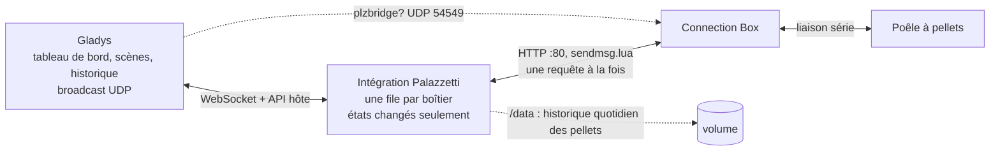
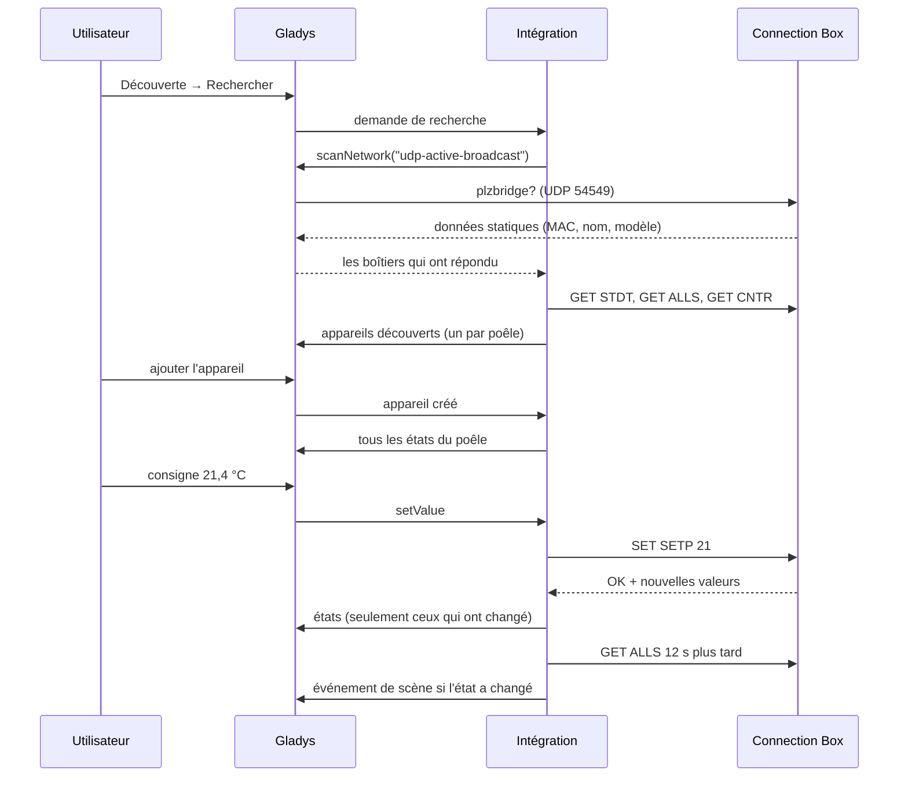
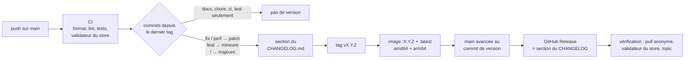

[English](README.md) · **Français** · [Deutsch](README.de.md) · [Español](README.es.md)

# gladys-palazzetti

[](LICENSE)
[](https://github.com/William-De71/gladys-palazzetti/releases)
[](https://github.com/William-De71/gladys-palazzetti/actions/workflows/release.yml)
[](https://gladysassistant.com)


Intégration externe [Gladys Assistant](https://gladysassistant.com) pour les poêles à pellets **Palazzetti**, via l'API locale de la **Connection Box**. Installée depuis le store en un clic, elle parle directement au boîtier sur votre réseau local : ni cloud Palazzetti, ni compte, ni passerelle MQTT. Allumez et éteignez le poêle, réglez la température, la puissance et la ventilation, suivez ses températures, ses alarmes et sa consommation de pellets, réagissez-y dans les scènes et pilotez-le depuis le tableau de bord.

📖 Documentation utilisateur : [English](docs/en.md) — [Français](docs/fr.md) — [Deutsch](docs/de.md) — [Español](docs/es.md)

Née du fil de la communauté Gladys [Connexion poêle Palazzetti](https://community.gladysassistant.com/t/connexion-poele-palazzetti/9943).

## Fonctionnalités

- **Découverte automatique** : Gladys diffuse la requête des Connection Box sur le réseau local ; un boîtier sur un autre VLAN se saisit à la main, et un boîtier qui change d'adresse IP est retrouvé par son identifiant.
- **Tout le poêle** : marche/arrêt, consigne, état de chauffe, températures, état, alarme, puissance, ventilation, mode silence, programmation horaire, pellets consommés, niveau de pellets et compteurs — selon le modèle.
- **Des commandes que le poêle accepte** : la marche/arrêt seulement depuis les états où le boîtier l'accepte, des valeurs bornées au modèle ; une commande refusée n'est jamais envoyée et Gladys dit pourquoi.
- **Scènes** : 6 déclencheurs (changement d'état, alarme, fin d'alarme, pellets bientôt vides, poêle injoignable / de nouveau joignable) et 2 actions (lire le poêle, régler le poêle).
- **Widgets de tableau de bord** : le poêle (tuiles en direct, courbe sur 24 h, état, boutons) et la consommation de pellets (kg par jour, sacs par semaine, compteurs).
- **Quatre langues** : anglais, français, allemand et espagnol, dans Gladys et dans la documentation.

## Fonctionnement




La Connection Box répond en HTTP simple sur le port 80 : `GET /cgi-bin/sendmsg.lua?cmd=GET+ALLS`, une enveloppe JSON `{ INFO, SUCCESS, DATA }`. Elle relaie chaque commande au poêle par une liaison série lente, donc :

- **une requête à la fois par boîtier** — des requêtes qui se chevauchent le font expirer ou planter (WPalaControl #69, Home Assistant #140215) ; chaque boîtier a sa propre file ;
- **une réponse n'est un succès que si `SUCCESS` est vrai _et_ `INFO.RSP` vaut `OK`** — le boîtier répond HTTP 200 avec `RSP: "TIMEOUT"` quand le poêle se tait ;
- **les commandes sont des valeurs absolues** (`SET SETP 21`, jamais `+1`), donc une requête restée sans réponse est relancée une fois sans risque.

Chaque poêle est lu en boucle : `GET ALLS` à chaque intervalle de lecture (30 s par défaut), `GET CNTR` toutes les 10 minutes, `GET STDT` une fois par jour. Le boîtier ne pousse rien ; c'est la boucle qui fait vivre les états, les scènes et les widgets.

De la recherche à une commande et son état :




### Découverte

Une Connection Box répond à la requête UDP `plzbridge?` diffusée sur le port **54549** avec ses données statiques, en unicast vers l'émetteur. Le conteneur de l'intégration est sur un réseau bridge et ne peut pas diffuser sur le réseau local, donc la requête passe par le cœur :

```json
"network_discovery": [{ "type": "udp-active-broadcast", "ports": [54549] }]
```

La recherche est fusionnée avec les adresses saisies dans la configuration et avec les poêles déjà créés. Quand un boîtier ne répond plus à trois lectures de suite (nouveau bail DHCP), une nouvelle recherche le retrouve par son identifiant et le paramètre `IP_ADDRESS` de l'appareil est mis à jour.

### Choix de représentation

- **La marche/arrêt est un `thermostat/mode`** (Éteint / Chauffe), à côté de `thermostat/target-temperature` et `thermostat/operating-state` : pour Gladys, le poêle est un thermostat qui ne fait que chauffer.
- **La puissance et la ventilation sont des `text/select`.** Gladys n'a pas de type « niveau de chauffe », et les ventilateurs prennent arrêt, 1–5, maximum et auto, ce que `fan/mode` (trois vitesses) ne sait pas décrire. Les options suivent ce que déclare le modèle (`FANLMINMAX`, `FAN2MODE`, `FAN2TYPE`).
- **L'alarme est un `unknown/binary`**, le seul binaire générique que le front Gladys sait libeller ; l'état en texte la nomme.
- **Les états sont regroupés en phases** (éteint, allumage, chauffe, éco, extinction, nettoyage, alarme) pour les déclencheurs. Le nettoyage périodique du brasier (état 11) reste « en chauffe » : il ne déclenche jamais de changement de phase.
- **Les capacités suivent pypalazzetti** et le SDK officiel Palazzetti : marche/arrêt seulement depuis les états que le boîtier accepte, pas de marche/arrêt à distance sur les poêles à bois, la sonde régulée d'après `MAINTPROBE`/`UICONFIG`, `65535` = non fourni, une sonde à 0 = absente.
- **La consommation par jour est calculée par l'intégration** : le poêle ne donne qu'un compteur cumulé, conservé jour par jour dans `/data/pellets-<id>.json`. Une petite baisse du compteur est un parasite ; une grande est une remise à zéro à l'entretien.


## Fonctionnalités prises en charge

| Fonctionnalité                          | Catégorie / type Gladys                           | Remarque                                                              |
| --------------------------------------- | ------------------------------------------------- | --------------------------------------------------------------------- |
| Marche / arrêt                          | `thermostat` / `mode`                             | Éteint / Chauffe ; refusée pendant l'allumage, l'extinction, l'alarme |
| Consigne                                | `thermostat` / `target-temperature`               | Au degré, dans la plage `SPLMIN`..`SPLMAX` du poêle                   |
| Chauffe                                 | `thermostat` / `operating-state`                  | Le poêle produit de la chaleur (allumage ou combustion)               |
| Température ambiante                    | `temperature-sensor` / `decimal`                  | La sonde régulée (l'eau régulée sur un poêle hydro)                   |
| Fumées, eau, sortie d'air               | `temperature-sensor` / `probe`                    | Les autres sondes présentes                                           |
| État                                    | `text` / `text`                                   | Combustion, Mode éco, Refroidissement… ou l'alarme en clair           |
| Alarme                                  | `unknown` / `binary`                              | 1 tant que le poêle est en alarme                                     |
| Puissance                               | `text` / `select`                                 | De 1 à 5                                                              |
| Ventilation, ventilateurs gauche/droit  | `text` / `select`                                 | Arrêt, vitesses, Maximum, Auto, selon le modèle                       |
| Mode silence                            | `button` / `push`                                 | Coupe tous les ventilateurs (modèles à plusieurs ventilateurs)        |
| Programmation horaire                   | `switch` / `binary`                               | La programmation du poêle (`CHRONOTYPE` > 1)                          |
| Pellets consommés (kg)                  | `counter-sensor` / `integer`                      | Compteur cumulé                                                       |
| Niveau de pellets / réservoir vide      | `level-sensor` / `liquid-depth`, `unknown/binary` | Selon le capteur du réservoir (`PSENSTYPE`)                           |
| Allumages, heures de chauffe, entretien | `counter-sensor`, `duration` / `integer`          | Relus toutes les 10 minutes (`GET CNTR`)                              |

Actions de la page de configuration : **Tester la connexion** (recherche les boîtiers et lit chaque poêle) et **Mettre à l'heure le poêle** (règle l'horloge utilisée par la programmation horaire sur l'heure de Gladys, après une coupure de courant ou un changement d'heure).

## Configuration

| Champ                       | Défaut | Usage                                                                                                      |
| --------------------------- | ------ | ---------------------------------------------------------------------------------------------------------- |
| Adresses des Connection Box | vide   | Uniquement si la recherche ne trouve pas votre poêle : adresses IP séparées par des virgules               |
| Intervalle de lecture (s)   | 30     | Fréquence de lecture de chaque poêle, de 10 à 300 s : le boîtier ne pousse rien, c'est le délai des scènes |

Si possible, donnez à la Connection Box une adresse IP fixe dans votre box internet : l'intégration retrouve un boîtier qui a changé d'adresse, mais quelques minutes plus tard.

## Transport

La Connection Box est uniquement locale : le manifeste déclare `"transports": ["local"]`, et chaque appareil poêle porte un badge de transport — **local** tant que son boîtier répond, **injoignable** après trois lectures sans réponse. Les mêmes transitions déclenchent les scènes _poêle injoignable_ et _poêle de nouveau joignable_.

## Widgets


- **Poêle Palazzetti** (`stove`) — la température ambiante et la consigne en tuiles en direct, la courbe des dernières 24 heures, l'état (l'alarme en rouge), la puissance, la ventilation, les fumées, les pellets et la programmation, et quatre boutons : Allumer / Éteindre (avec confirmation pour éteindre), −1 °C, +1 °C et Puissance → suivante. Réglages : le poêle, la courbe de température (sans elle, la puissance s'affiche en tuile).
- **Consommation de pellets** (`consumption`) — pellets consommés aujourd'hui, moyenne par jour, total, l'histogramme des derniers jours, sacs de 15 kg par semaine, allumages, heures de chauffe et heures depuis l'entretien. Réglages : le poêle, les jours affichés (7 à 60, 14 par défaut). L'historique quotidien est calculé à partir du compteur du poêle : il apparaît après une première journée complète.

Les images sont générées à partir du code des widgets par `docs/illustrations/render.sh` (une soirée d'hiver inventée, dessinée comme le front Gladys) : ce ne sont pas des captures d'un Gladys en marche.

## Scènes

Chaque déclencheur peut être limité à un poêle (vide pour tous). Le poêle est lu en boucle : un déclencheur part au plus un intervalle de lecture après les faits.

| Déclencheur                             | Quand                                                                                          | Variables                                                                                                     |
| --------------------------------------- | ---------------------------------------------------------------------------------------------- | ------------------------------------------------------------------------------------------------------------- |
| Palazzetti : changement d'état du poêle | Nouvel état : Éteint, Allumage, En chauffe, Veille éco, Extinction, Nettoyage final, Alarme    | `phase`, `previous_phase`, `phase_label`, `status_label`, `status_code`, `temperature`, `setpoint`, `summary` |
| Palazzetti : alarme                     | Une alarme apparaît, filtrable par type : plus de pellets, porte, surchauffe, tirage, conduit… | `alarm_label`, `alarm_type`, `alarm_code`, `summary`                                                          |
| Palazzetti : fin d'alarme               | Le poêle n'est plus en alarme                                                                  | `alarm_label`, `alarm_code`, `phase`, `summary`                                                               |
| Palazzetti : pellets bientôt vides      | Le capteur du réservoir signale un niveau bas (modèles équipés)                                | `pellet_level`, `summary`                                                                                     |
| Palazzetti : poêle injoignable          | La Connection Box n'a pas répondu à trois lectures de suite                                    | `summary`                                                                                                     |
| Palazzetti : poêle de nouveau joignable | Elle répond de nouveau                                                                         | `phase`, `temperature`, `summary`                                                                             |

Chaque déclencheur donne aussi `stove_name`. `summary` (Résumé) est une phrase prête à envoyer, par exemple « Salon est en alarme : Plus de pellets. »

| Action                       | Champs                                                  | Sorties                                                                                                                                                                                |
| ---------------------------- | ------------------------------------------------------- | -------------------------------------------------------------------------------------------------------------------------------------------------------------------------------------- |
| Palazzetti : lire le poêle   | poêle                                                   | `stove_name`, `on`, `heating`, `phase`, `status_label`, `alarm`, `alarm_label`, `temperature`, `setpoint`, `power_level`, `fan`, `flue_gas_temperature`, `pellets_consumed`, `summary` |
| Palazzetti : régler le poêle | poêle, marche / arrêt, consigne, puissance, ventilation | `changed`, `phase`, `summary`                                                                                                                                                          |

**Régler le poêle** envoie les réglages avant l'allumage, pour que le poêle démarre avec la bonne consigne ; les champs vides ne changent rien, et une valeur refusée (alarme, vitesse non proposée par le modèle) fait échouer l'action avec la raison. Les événements naissent des transitions lues sur le poêle, jamais d'une action de l'intégration elle-même.

Exemples :

- _Palazzetti : alarme_, type « Plus de pellets » → envoyer un message `{{summary}}`.
- _Palazzetti : changement d'état du poêle_ vers « Éteint » → fermer les volets roulants.
- Chaque jour de semaine à 06:00, quand la maison est occupée → _Palazzetti : régler le poêle_ : Allumer, consigne 20 °C, puissance 3.
- _Palazzetti : lire le poêle_ à 22:00, puis une condition sur `on` → l'éteindre si personne n'est à la maison.

## Installation

1. Dans Gladys (5.1.1 ou plus récent) : **Intégrations → Store**, cherchez **Palazzetti**, installez.
2. **Découverte → Rechercher**, puis ajoutez votre poêle. Introuvable ? Saisissez l'adresse IP de la Connection Box dans la configuration et relancez la recherche.
3. Ajoutez les widgets **Poêle Palazzetti** et **Consommation de pellets** au tableau de bord.

La [documentation utilisateur](docs/fr.md) détaille les prérequis, les fonctionnalités de l'appareil, les scènes et le dépannage.

## Développement

```bash
npm install
GLADYS_HOST_API_URL="http://localhost:1443" \
GLADYS_INTEGRATION_TOKEN="<token>" \
GLADYS_INTEGRATION_SELECTOR="palazzetti" \
DATA_DIR=./data \
npm start
```

```
index.js                     câblage du SDK seulement : createApp(new GladysIntegration()) + connect
src/
  app.js                     tous les handlers : découverte, commandes, scènes, widgets, actions
  config.js                  normalisation de la configuration, adresses saisies, langues
  manager.js                 poêles connus, boucle de lecture, commandes, suivi d'IP
  device.js                  appareil Gladys et états d'un poêle
  commands.js                valeur Gladys -> commande du boîtier, refus expliqués
  events.js                  transitions d'une lecture à l'autre -> événements de scène
  scene-actions.js           get_status / control
  widgets.js                 contenus des widgets poêle et consommation
  history.js                 historique quotidien des pellets dans /data
  i18n.js                    tous les textes d'exécution, en / fr / de / es
  palazzetti/
    client.js                client HTTP : une file par boîtier, contrôle de l'enveloppe
    discovery.js             requête UDP, réponses, identifiant stable du poêle
    stove.js                 capacités et valeurs d'un poêle
    constants.js             états, phases, alarmes, ventilateurs
docs/illustrations/          render.sh : les images générées des widgets de docs/assets
```

L'identifiant de plateforme est l'**adresse MAC du boîtier** (Wi-Fi d'abord, puis l'interface active, puis Ethernet), le numéro de série quand aucune MAC n'est valide. Jamais l'IP (DHCP) ni le nom (modifiable dans l'application Palazzetti).

```
device : ext:<selector>:stove:<mac>
feature: ext:<selector>:stove:<mac>:<key>     key = mode, setpoint, room, fan-main, ...
```

## Tests

```bash
npm test               # node --test, ne touche jamais au réseau
npm run lint           # ESLint
npm run format:check   # Prettier, comme la CI
npx github:GladysAssistant/integration-store . --skip-image-check
docs/illustrations/render.sh   # après toute modification d'un contenu de widget
```

Les tests tournent sur de vraies réponses de Connection Box (Ginger, Julie Pro 2) et valident chaque contenu de widget avec `validateWidgetContent` du SDK. `test/structure.test.js` compare la découverte à `test/fixtures/discovery.baseline.json` et les clés du manifeste à `test/fixtures/manifest.baseline.json`, tous deux générés depuis la v1.0.1 : un identifiant externe, une catégorie, un type ou une clé qui change obligerait les utilisateurs à recréer leurs appareils ou leurs scènes. `test/app.test.js` pilote les handlers avec le faux Gladys du SDK ; `test/i18n.test.js` vérifie les quatre langues du manifeste, des messages, des docs et de ces README.

## Publication

Les versions sont automatiques. Chaque push sur `main` lance la CI, puis calcule la version suivante à partir des Conventional Commits depuis le dernier tag :



Le manifeste n'arrive sur `main` qu'une fois son image publiée : le store n'annonce jamais une version qu'il ne peut pas télécharger. `CHANGELOG.md` est généré : ne l'éditez jamais à la main. **Actions → Release → Run workflow** propose `release-as` (forcer une version) et `dry-run` (afficher la version et les notes sans rien publier).

Les titres de commits et de pull requests suivent les [Conventional Commits](https://www.conventionalcommits.org/), en anglais, écrits comme la ligne du changelog que l'utilisateur lira : `feat(widgets): show the pellet level on the stove widget`.

- Une branche `main` protégée refuserait le commit de version : autorisez GitHub Actions à contourner la règle (Settings → Rules → Bypass list), ou utilisez le jeton d'une GitHub App.
- La vérification exige le topic `gladys-assistant-integration` sur le dépôt (**About → ⚙️ → Topics**), à côté de `gladys`, `palazzetti`, `pellet-stove`, `connection-box`, `home-automation`. La description **About** reprend la `description` du manifeste.

## Dépannage

| Symptôme                              | Cause probable                                                                                                                                         |
| ------------------------------------- | ------------------------------------------------------------------------------------------------------------------------------------------------------ |
| Aucun poêle trouvé                    | Broadcast filtré (VLAN, Wi-Fi invité) : saisissez l'adresse du boîtier ; `http://IP_DU_BOITIER/cgi-bin/sendmsg.lua?cmd=GET+STAT` doit renvoyer du JSON |
| « Le poêle ne répond pas au boîtier » | Le boîtier répond mais pas le poêle : vérifiez le câble entre les deux et que le poêle est sous tension                                                |
| Une commande est refusée              | Pas de marche/arrêt pendant un allumage, une extinction ou une alarme ; la ventilation n'accepte que les vitesses du modèle                            |
| Les températures restent vides        | Une sonde à 0 est considérée comme absente : certains modèles n'ont pas toutes les sondes                                                              |
| La consommation par jour est vide     | Elle se remplit au fil des jours ; certaines cartes d'autres marques ne donnent pas leur compteur de pellets                                           |

Journaux : **Intégrations → Palazzetti → Journaux** ; ajoutez `DEBUG=gladys-integration-sdk` au conteneur pour le détail du SDK.

## Contribuer

Les issues et pull requests sont bienvenues : [signaler un bug](https://github.com/William-De71/gladys-palazzetti/issues/new?template=bug_report.yml) (versions de Gladys et de l'intégration, modèle du poêle, journaux) ou [proposer une fonctionnalité](https://github.com/William-De71/gladys-palazzetti/issues/new?template=feature_request.yml). Retours et questions aussi sur le [fil du forum](https://community.gladysassistant.com/t/9943). Problèmes de sécurité : voir [SECURITY.md](SECURITY.md).

La connaissance du protocole vient de [pypalazzetti](https://github.com/dotvav/py-palazzetti-api) (la bibliothèque de l'intégration Home Assistant), du [SDK officiel Palazzetti asset parser](https://github.com/palazzetti/palazzetti-sdk-asset-parser-nodejs) et de l'émulateur [WPalaControl](https://github.com/Domochip/WPalaControl). Construite sur le [SDK d'intégration Gladys](https://github.com/GladysAssistant/integration-sdk-js).

## Licence

[Apache-2.0](LICENSE) — voir aussi [NOTICE](NOTICE). Intégration communautaire, non affiliée à Palazzetti Lelio S.p.A. ni approuvée par elle ; « Palazzetti » et son logo sont des marques de leur propriétaire, citées ici uniquement pour identifier les poêles compatibles.
