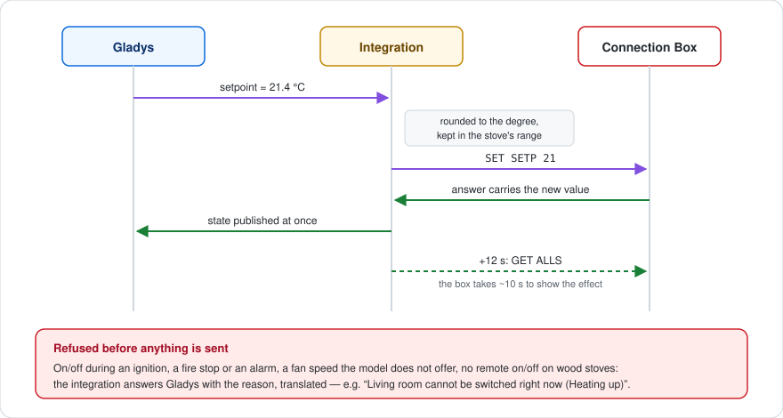

# gladys-palazzetti

Gladys Assistant external integration for **Palazzetti** pellet stoves, over the local API of the Connection Box.


Installable in one click from [Gladys Assistant](https://gladysassistant.com), it talks to the stove's **Connection Box** directly on your local network — no Palazzetti cloud, no account, no MQTT bridge. Switch the stove on and off, set the temperature, the power level and the fans, follow its temperatures, alarms and pellet consumption, react to it in scenes and drive it from the dashboard.

📖 User documentation: [English](docs/en.md) — [Français](docs/fr.md) — [Deutsch](docs/de.md) — [Español](docs/es.md)

Born from the Gladys community thread [Connexion poêle Palazzetti](https://community.gladysassistant.com/t/connexion-poele-palazzetti/9943).


## What it brings

| Surface              | Content                                                                                                                                                                                                 |
| -------------------- | ------------------------------------------------------------------------------------------------------------------------------------------------------------------------------------------------------- |
| **Device**           | On/off, setpoint, heating state, room (or water) temperature, other probes, status, alarm, power level, fans, silent mode, weekly schedule, pellets burnt, pellet level, counters — as the model allows |
| **Scene triggers**   | State changed (filter on the new state), alarm (filter on its type), alarm cleared, pellets running low, stove unreachable / reachable again                                                            |
| **Scene actions**    | Read the stove (scalar outputs), set the stove (on/off, setpoint, power, fan in one action)                                                                                                             |
| **Widgets**          | The stove (live tiles, 24 h curve, state, on/off and ± buttons), pellet consumption (kg per day, bags per week, counters)                                                                               |
| **Settings actions** | Test the connection, set the stove clock                                                                                                                                                                |

Everything the integration writes is translated in English, French, German and Spanish.

## How it works

The Connection Box answers plain HTTP on port 80: `GET /cgi-bin/sendmsg.lua?cmd=GET+ALLS`, a JSON envelope `{ INFO, SUCCESS, DATA }`. It relays every command to the stove over a slow serial link, so:

- **one request at a time per box** — overlapping requests make it time out or crash (WPalaControl #69, Home Assistant #140215); each box gets its own queue;
- **an answer is a success only when `SUCCESS` is true _and_ `INFO.RSP` is `OK`** — the box answers HTTP 200 with `RSP: "TIMEOUT"` when the stove is silent;
- **commands are absolute values** (`SET SETP 21`, never `+1`), so a request the box did not answer is safely retried once.



Each stove is read on a loop: `GET ALLS` every poll interval (30 s by default), `GET CNTR` every 10 minutes, `GET STDT` once a day. The box pushes nothing; the loop is what drives the scenes.

## Discovery

A Connection Box answers the UDP probe `plzbridge?` broadcast on port **54549** with its static data, in unicast towards the emitter. The integration container sits on a bridge network and cannot broadcast to the LAN, so the probe goes through the core:

```json
"network_discovery": [{ "type": "udp-active-broadcast", "ports": [54549] }]
```

The scan is merged with the addresses typed in the settings and with the stoves already created. When a box stops answering three reads in a row (new DHCP lease), a new scan finds it again by its id and the device's `IP_ADDRESS` param is updated.

## External-id scheme

The platform id is the **MAC address of the box** (Wi-Fi first, then the active interface, then Ethernet), the serial number when no MAC is valid. Never the IP (DHCP) nor the label (renamable in the Palazzetti app).

```
device : ext:<selector>:stove:<mac>
feature: ext:<selector>:stove:<mac>:<key>     key = mode, setpoint, room, fan-main, ...
```

## Mapping choices

- **On/off is `thermostat/mode`** (Off / Heating), next to `thermostat/target-temperature` and `thermostat/operating-state`: the stove is a heat-only thermostat for Gladys.
- **Power level and fans are `text/select`.** Gladys has no "heat level" type, and the fans take off, 1–5, high and auto, which `fan/mode` (three speeds) cannot describe. The options follow what the model reports (`FANLMINMAX`, `FAN2MODE`, `FAN2TYPE`).
- **The alarm is `unknown/binary`**, the only generic binary the Gladys front labels; the status text names it.
- **Statuses are grouped into phases** (off, ignition, heating, eco, cooling, cleaning, alarm) for the triggers. The periodic brazier cleaning (status 11) stays "heating", so it never fires a phase change.
- **Capabilities follow pypalazzetti** and the official Palazzetti SDK: on/off only from the statuses the box accepts it in, no remote on/off on wood stoves, the regulated probe from `MAINTPROBE`/`UICONFIG`, `65535` = not provided, a probe at 0 = absent.
- **Daily consumption is computed by the integration**: the stove only reports a cumulative counter, kept per day in `/data/pellets-<id>.json`. Small drops of the counter are glitches; a large one is a reset at service time.


## Architecture

```
index.js                     SDK wiring: devices, commands, scenes, widgets, actions
src/
  config.js                  config normalization, typed addresses, languages
  manager.js                 known stoves, read loop, commands, IP follow-up
  device.js                  Gladys device and states of a stove
  commands.js                Gladys value -> box command, with the refusals explained
  events.js                  read-to-read transitions -> scene events
  scene-actions.js           get_status / control
  widgets.js                 stove and consumption widget contents
  history.js                 daily pellet history in /data
  i18n.js                    every runtime text, in en / fr / de / es
  palazzetti/
    client.js                HTTP client: one queue per box, envelope checks
    discovery.js             UDP probe, replies, stable stove id
    stove.js                 capabilities and values of a stove
    constants.js             statuses, phases, alarms, fans
```

## Development

```bash
npm install
GLADYS_HOST_API_URL="http://localhost:1443" \
GLADYS_INTEGRATION_TOKEN="<token>" \
GLADYS_INTEGRATION_SELECTOR="palazzetti" \
DATA_DIR=./data \
npm start
```

```bash
npm test          # node --test
npm run lint      # eslint
npm run format    # prettier
```

The tests run on real Connection Box answers (Ginger, Julie Pro 2) and check every widget content with the SDK's `validateWidgetContent`.

Releases are cut from GitHub: **Actions → Release → Run workflow**, then pick the bump. The workflow updates the version in `package.json` and the manifest (version **and** `docker_image` tag), regenerates `CHANGELOG.md` from the Conventional Commits, pushes the commit and the tag in one atomic push, publishes the GitHub release and builds the multi-arch image (amd64 + arm64), with the manifest shipped as an image label.

## Credits

The protocol knowledge comes from [pypalazzetti](https://github.com/dotvav/py-palazzetti-api) (the library of the Home Assistant integration), the [official Palazzetti asset parser SDK](https://github.com/palazzetti/palazzetti-sdk-asset-parser-nodejs) and the [WPalaControl](https://github.com/Domochip/WPalaControl) emulator. Built on the [Gladys integration SDK](https://github.com/GladysAssistant/integration-sdk-js).

Community integration, not affiliated with nor endorsed by Palazzetti Lelio S.p.A. "Palazzetti" and its logo are trademarks of their owner, used here only to identify the stoves this integration works with.

## Repository topics

Set these as the repository topics on GitHub (**About → ⚙️ → Topics**):

```
gladys  gladys-assistant  palazzetti  pellet-stove  connection-box  home-automation  domotique  smart-home  heating  nodejs
```

The GitHub **About** description mirrors the first line of this README and the `description` field of `gladys-assistant-integration.json` — keep the three in sync when one changes.

## License

[Apache-2.0](LICENSE)
