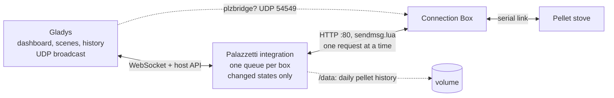
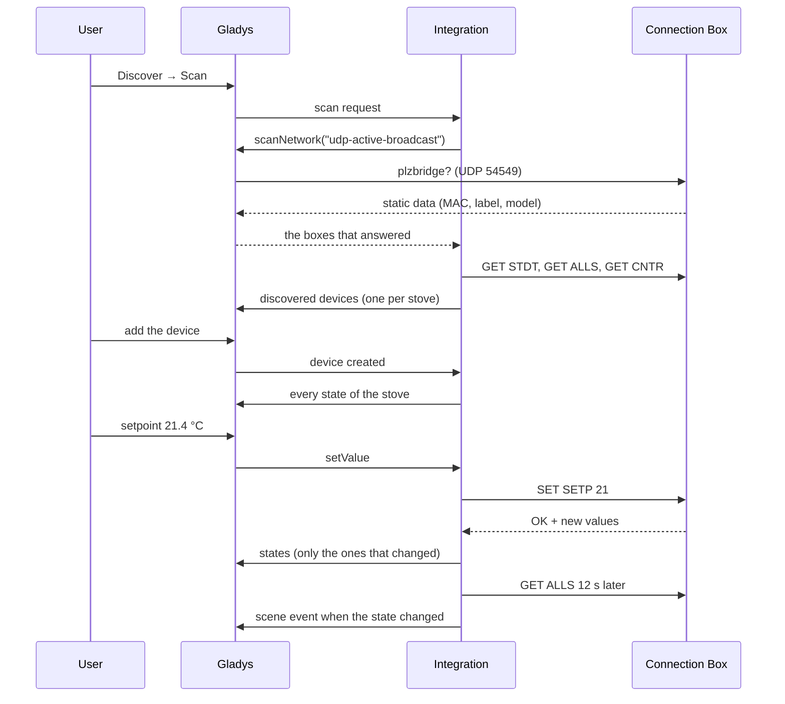
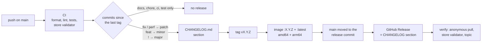

**English** · [Français](README.fr.md) · [Deutsch](README.de.md) · [Español](README.es.md)

# gladys-palazzetti

[](LICENSE)
[](https://github.com/William-De71/gladys-palazzetti/releases)
[](https://github.com/William-De71/gladys-palazzetti/actions/workflows/release.yml)
[](https://gladysassistant.com)


External [Gladys Assistant](https://gladysassistant.com) integration for **Palazzetti** pellet stoves, over the local API of the **Connection Box**. Installed from the store in one click, it talks to the box directly on your local network: no Palazzetti cloud, no account, no MQTT bridge. Switch the stove on and off, set the temperature, the power level and the fans, follow its temperatures, alarms and pellet consumption, react to it in scenes and drive it from the dashboard.

📖 User documentation: [English](docs/en.md) — [Français](docs/fr.md) — [Deutsch](docs/de.md) — [Español](docs/es.md)

Born from the Gladys community thread [Connexion poêle Palazzetti](https://community.gladysassistant.com/t/connexion-poele-palazzetti/9943).

## Features

- **Automatic discovery**: Gladys broadcasts the Connection Box probe on the LAN; a box on another VLAN can be typed by hand, and a box that changes IP address is found again by its id.
- **The whole stove**: on/off, setpoint, heating state, temperatures, status, alarm, power level, fans, silent mode, weekly schedule, pellets burnt, pellet level and counters — as the model allows.
- **Commands the stove accepts**: on/off only from the states the box accepts it in, values bounded to the model; a refused command is never sent and Gladys says why.
- **Scenes**: 6 triggers (state changed, alarm, alarm cleared, pellets running low, stove unreachable / reachable again) and 2 actions (read the stove, set the stove).
- **Dashboard widgets**: the stove (live tiles, 24 h curve, state, buttons) and the pellet consumption (kg per day, bags per week, counters).
- **Four languages**: English, French, German and Spanish, in Gladys and in the documentation.

## How it works




The Connection Box answers plain HTTP on port 80: `GET /cgi-bin/sendmsg.lua?cmd=GET+ALLS`, a JSON envelope `{ INFO, SUCCESS, DATA }`. It relays every command to the stove over a slow serial link, so:

- **one request at a time per box** — overlapping requests make it time out or crash (WPalaControl #69, Home Assistant #140215); each box gets its own queue;
- **an answer is a success only when `SUCCESS` is true _and_ `INFO.RSP` is `OK`** — the box answers HTTP 200 with `RSP: "TIMEOUT"` when the stove is silent;
- **commands are absolute values** (`SET SETP 21`, never `+1`), so a request the box did not answer is safely retried once.

Each stove is read on a loop: `GET ALLS` every poll interval (30 s by default), `GET CNTR` every 10 minutes, `GET STDT` once a day. The box pushes nothing; the loop is what drives the states, the scenes and the widgets.

From the scan to a command and its state:




### Discovery

A Connection Box answers the UDP probe `plzbridge?` broadcast on port **54549** with its static data, in unicast towards the emitter. The integration container sits on a bridge network and cannot broadcast to the LAN, so the probe goes through the core:

```json
"network_discovery": [{ "type": "udp-active-broadcast", "ports": [54549] }]
```

The scan is merged with the addresses typed in the settings and with the stoves already created. When a box stops answering three reads in a row (new DHCP lease), a new scan finds it again by its id and the device's `IP_ADDRESS` param is updated.

### Mapping choices

- **On/off is `thermostat/mode`** (Off / Heating), next to `thermostat/target-temperature` and `thermostat/operating-state`: the stove is a heat-only thermostat for Gladys.
- **Power level and fans are `text/select`.** Gladys has no "heat level" type, and the fans take off, 1–5, high and auto, which `fan/mode` (three speeds) cannot describe. The options follow what the model reports (`FANLMINMAX`, `FAN2MODE`, `FAN2TYPE`).
- **The alarm is `unknown/binary`**, the only generic binary the Gladys front labels; the status text names it.
- **Statuses are grouped into phases** (off, ignition, heating, eco, cooling, cleaning, alarm) for the triggers. The periodic brazier cleaning (status 11) stays "heating", so it never fires a phase change.
- **Capabilities follow pypalazzetti** and the official Palazzetti SDK: on/off only from the statuses the box accepts it in, no remote on/off on wood stoves, the regulated probe from `MAINTPROBE`/`UICONFIG`, `65535` = not provided, a probe at 0 = absent.
- **Daily consumption is computed by the integration**: the stove only reports a cumulative counter, kept per day in `/data/pellets-<id>.json`. Small drops of the counter are glitches; a large one is a reset at service time.


## Supported features

| Feature                                 | Gladys category / type                            | Note                                                       |
| --------------------------------------- | ------------------------------------------------- | ---------------------------------------------------------- |
| On / off                                | `thermostat` / `mode`                             | Off / Heating; refused during ignition, shutdown and alarm |
| Setpoint                                | `thermostat` / `target-temperature`               | Whole degrees, within `SPLMIN`..`SPLMAX` of the stove      |
| Heating                                 | `thermostat` / `operating-state`                  | The stove is producing heat (ignition or combustion)       |
| Room temperature                        | `temperature-sensor` / `decimal`                  | The regulated probe (the regulated water on a hydro stove) |
| Flue gas, water, air outlet             | `temperature-sensor` / `probe`                    | The other probes present                                   |
| Status                                  | `text` / `text`                                   | Burning, Eco mode, Cooling down… or the alarm in words     |
| Alarm                                   | `unknown` / `binary`                              | 1 while the stove is in alarm                              |
| Power level                             | `text` / `select`                                 | 1 to 5                                                     |
| Room fan, left / right fans             | `text` / `select`                                 | Off, speeds, High, Auto, as the model offers               |
| Silent mode                             | `button` / `push`                                 | Every fan off (models with several fans)                   |
| Weekly schedule                         | `switch` / `binary`                               | The schedule of the stove (`CHRONOTYPE` > 1)               |
| Pellets burnt (kg)                      | `counter-sensor` / `integer`                      | Cumulative counter                                         |
| Pellet level / hopper empty             | `level-sensor` / `liquid-depth`, `unknown/binary` | Depending on the hopper sensor (`PSENSTYPE`)               |
| Ignitions, heating hours, since service | `counter-sensor`, `duration` / `integer`          | Read every 10 minutes (`GET CNTR`)                         |

Settings actions: **Test the connection** (looks for the boxes and reads every stove) and **Set the stove clock** (sets the clock the weekly schedule uses to the time of Gladys, after a power cut or a daylight saving change).

## Configuration

| Field                    | Default | Use                                                                                      |
| ------------------------ | ------- | ---------------------------------------------------------------------------------------- |
| Connection Box addresses | empty   | Only if the scan does not find your stove: IP addresses separated by commas              |
| Refresh interval (s)     | 30      | How often each stove is read, 10 to 300 s: the box pushes nothing, it is the scene delay |

Give the Connection Box a fixed IP address in your router if you can: the integration finds a moved box again, but a few minutes later.

## Transport

The Connection Box is local only: the manifest declares `"transports": ["local"]`, and each stove device carries a transport badge — **local** while its box answers, **unreachable** after three reads without an answer. The same transitions fire the scene triggers _stove unreachable_ and _stove reachable again_.

## Widgets


- **Palazzetti stove** (`stove`) — the room temperature and the setpoint as live tiles, the curve of the last 24 hours, the state (alarm in red), power, fan, flue gas, pellets and schedule, and four buttons: Turn on / Turn off (turning off asks for a confirmation), −1 °C, +1 °C and Power → next. Settings: the stove, the temperature curve (without it, the power level gets a tile).
- **Pellet consumption** (`consumption`) — pellets burnt today, average per day, total, the bars of the last days, 15 kg bags per week, ignitions, heating hours and hours since service. Settings: the stove, the days shown (7 to 60, 14 by default). The daily history is computed from the counter of the stove: it shows after a first full day.

The images are generated from the widget code by `docs/illustrations/render.sh` (made-up winter evening, drawn like the Gladys front), not screenshots of a running Gladys.

## Scenes

Each trigger can be limited to one stove (empty for any). The stove is read on a loop, so a trigger fires at most one refresh interval after the fact.

| Trigger                           | When                                                                                         | Variables                                                                                                     |
| --------------------------------- | -------------------------------------------------------------------------------------------- | ------------------------------------------------------------------------------------------------------------- |
| Palazzetti: stove state changed   | New state: Off, Igniting, Heating, Eco standby, Shutting down, Final cleaning, Alarm         | `phase`, `previous_phase`, `phase_label`, `status_label`, `status_code`, `temperature`, `setpoint`, `summary` |
| Palazzetti: alarm                 | An alarm is raised, filterable by type: out of pellets, door, overheating, draught, chimney… | `alarm_label`, `alarm_type`, `alarm_code`, `summary`                                                          |
| Palazzetti: alarm cleared         | The stove is no longer in alarm                                                              | `alarm_label`, `alarm_code`, `phase`, `summary`                                                               |
| Palazzetti: pellets running low   | The hopper sensor reports a low level (equipped models)                                      | `pellet_level`, `summary`                                                                                     |
| Palazzetti: stove unreachable     | The Connection Box has not answered three reads in a row                                     | `summary`                                                                                                     |
| Palazzetti: stove reachable again | It answers again                                                                             | `phase`, `temperature`, `summary`                                                                             |

Every trigger also gives `stove_name`. `summary` is a sentence ready to send, e.g. "Living room is in alarm: Out of pellets."

| Action                     | Fields                                           | Outputs                                                                                                                                                                                |
| -------------------------- | ------------------------------------------------ | -------------------------------------------------------------------------------------------------------------------------------------------------------------------------------------- |
| Palazzetti: read the stove | stove                                            | `stove_name`, `on`, `heating`, `phase`, `status_label`, `alarm`, `alarm_label`, `temperature`, `setpoint`, `power_level`, `fan`, `flue_gas_temperature`, `pellets_consumed`, `summary` |
| Palazzetti: set the stove  | stove, on / off, setpoint, power level, room fan | `changed`, `phase`, `summary`                                                                                                                                                          |

**Set the stove** sends the settings before the ignition, so the stove starts with the right setpoint; empty fields change nothing, and a refused value (alarm, a speed the model does not offer) fails the action with the reason. Events are fired on transitions read from the stove, never by an action of the integration itself.

Examples:

- _Palazzetti: alarm_, type "Out of pellets" → send a message `{{summary}}`.
- _Palazzetti: stove state changed_ to "Off" → close the shutters.
- Every weekday at 06:00, when the house is occupied → _Palazzetti: set the stove_: Turn on, setpoint 20 °C, power 3.
- _Palazzetti: read the stove_ at 22:00, then a condition on `on` → turn it off if nobody is home.

## Installation

1. In Gladys (5.1.1 or newer): **Integrations → Store**, search for **Palazzetti**, install.
2. **Discover → Scan**, then add your stove. Not found? Type the IP address of the Connection Box in the configuration and scan again.
3. Add the **Palazzetti stove** and **Pellet consumption** widgets to the dashboard.

The [user documentation](docs/en.md) details the requirements, the features of the device, the scenes and the troubleshooting.

## Development

```bash
npm install
GLADYS_HOST_API_URL="http://localhost:1443" \
GLADYS_INTEGRATION_TOKEN="<token>" \
GLADYS_INTEGRATION_SELECTOR="palazzetti" \
DATA_DIR=./data \
npm start
```

```
index.js                     SDK wiring only: createApp(new GladysIntegration()) + connect
src/
  app.js                     every handler: discovery, commands, scenes, widgets, actions
  config.js                  config normalization, typed addresses, languages
  manager.js                 known stoves, read loop, commands, IP follow-up
  device.js                  Gladys device and states of a stove
  commands.js                Gladys value -> box command, with the refusals explained
  events.js                  read-to-read transitions -> scene events
  scene-actions.js           get_status / control
  widgets.js                 stove and consumption widget contents
  history.js                 daily pellet history in /data
  i18n.js                    every runtime text, in en / fr / de / es
  palazzetti/
    client.js                HTTP client: one queue per box, envelope checks
    discovery.js             UDP probe, replies, stable stove id
    stove.js                 capabilities and values of a stove
    constants.js             statuses, phases, alarms, fans
docs/illustrations/          render.sh: the generated widget images of docs/assets
```

The platform id is the **MAC address of the box** (Wi-Fi first, then the active interface, then Ethernet), the serial number when no MAC is valid. Never the IP (DHCP) nor the label (renamable in the Palazzetti app).

```
device : ext:<selector>:stove:<mac>
feature: ext:<selector>:stove:<mac>:<key>     key = mode, setpoint, room, fan-main, ...
```

## Tests

```bash
npm test               # node --test, never touches the network
npm run lint           # ESLint
npm run format:check   # Prettier, as the CI runs it
npx github:GladysAssistant/integration-store . --skip-image-check
docs/illustrations/render.sh   # after any change to a widget content
```

The tests run on real Connection Box answers (Ginger, Julie Pro 2) and check every widget content with the SDK's `validateWidgetContent`. `test/structure.test.js` compares the discovery with `test/fixtures/discovery.baseline.json` and the manifest keys with `test/fixtures/manifest.baseline.json`, both generated from v1.0.1: an external id, a category, a type or a key that changes would force users to recreate their devices or scenes. `test/app.test.js` drives the handlers with the fake Gladys of the SDK; `test/i18n.test.js` checks the four languages of the manifest, the messages, the docs and these READMEs.

## Release

Releases are automatic. Every push on `main` runs the CI, then computes the next version from the Conventional Commits since the last tag:



The manifest only reaches `main` once its image exists, so the store never announces a version it cannot pull. `CHANGELOG.md` is generated: never edit it by hand. **Actions → Release → Run workflow** offers `release-as` (force a version) and `dry-run` (show the version and the notes without publishing).

Commit and pull request titles follow [Conventional Commits](https://www.conventionalcommits.org/), in English, written as the changelog line the user will read: `feat(widgets): show the pellet level on the stove widget`.

- A protected `main` would reject the release commit: allow GitHub Actions to bypass the rule (Settings → Rules → Bypass list), or use a GitHub App token.
- The verification needs the `gladys-assistant-integration` topic on the repository (**About → ⚙️ → Topics**), next to `gladys`, `palazzetti`, `pellet-stove`, `connection-box`, `home-automation`. The **About** description mirrors the `description` of the manifest.

## Troubleshooting

| Symptom                             | Likely cause                                                                                                                    |
| ----------------------------------- | ------------------------------------------------------------------------------------------------------------------------------- |
| No stove found                      | Broadcast filtered (VLAN, guest Wi-Fi): type the box address; `http://BOX_IP/cgi-bin/sendmsg.lua?cmd=GET+STAT` must return JSON |
| "The stove does not answer the box" | The box answers but not the stove: check the cable between them and that the stove is powered                                   |
| A command is refused                | No on/off during ignition, shutdown or alarm; the fans only take the speeds the model offers                                    |
| Temperatures stay empty             | A probe at 0 is treated as absent: some models do not have every probe                                                          |
| The daily consumption is empty      | It fills up day after day; some boards of other brands do not report their pellet counter                                       |

Logs: **Integrations → Palazzetti → Logs**; add `DEBUG=gladys-integration-sdk` to the container for the SDK details.

## Contributing

Issues and pull requests are welcome: [bug report](https://github.com/William-De71/gladys-palazzetti/issues/new?template=bug_report.yml) (Gladys, integration and stove model, logs) or [feature request](https://github.com/William-De71/gladys-palazzetti/issues/new?template=feature_request.yml). Feedback and questions also go to the [forum thread](https://community.gladysassistant.com/t/9943). Security problems: see [SECURITY.md](SECURITY.md).

The protocol knowledge comes from [pypalazzetti](https://github.com/dotvav/py-palazzetti-api) (the library of the Home Assistant integration), the [official Palazzetti asset parser SDK](https://github.com/palazzetti/palazzetti-sdk-asset-parser-nodejs) and the [WPalaControl](https://github.com/Domochip/WPalaControl) emulator. Built on the [Gladys integration SDK](https://github.com/GladysAssistant/integration-sdk-js).

## License

[Apache-2.0](LICENSE) — see also [NOTICE](NOTICE). Community integration, not affiliated with nor endorsed by Palazzetti Lelio S.p.A.; "Palazzetti" and its logo are trademarks of their owner, used here only to identify the stoves this integration works with.
